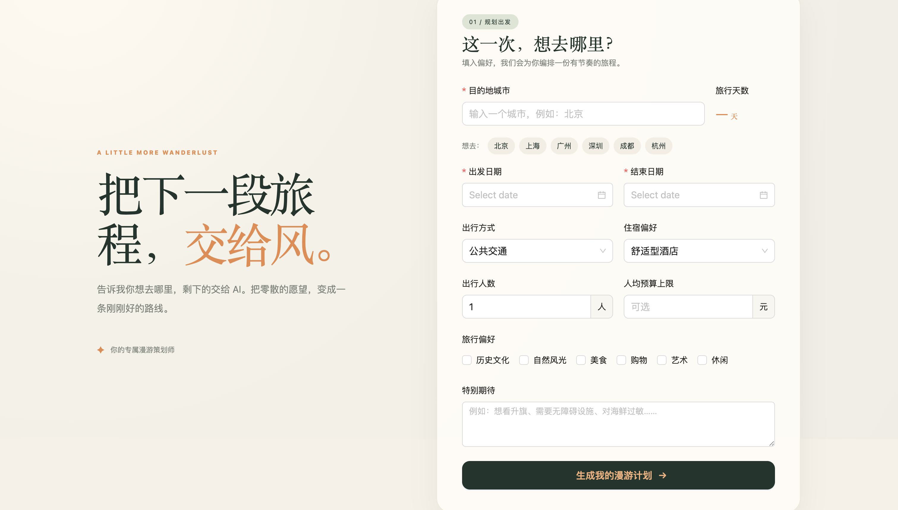
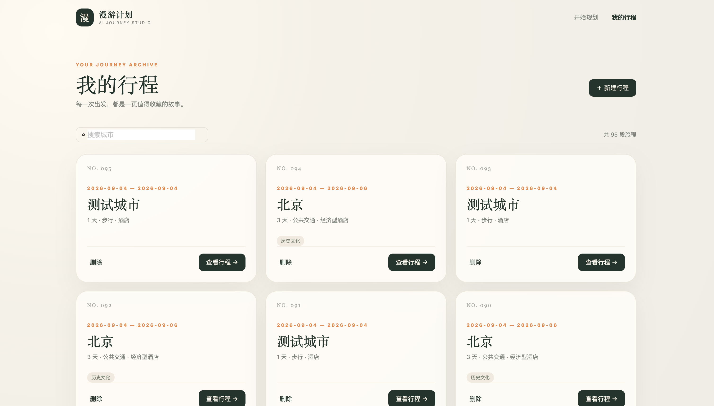
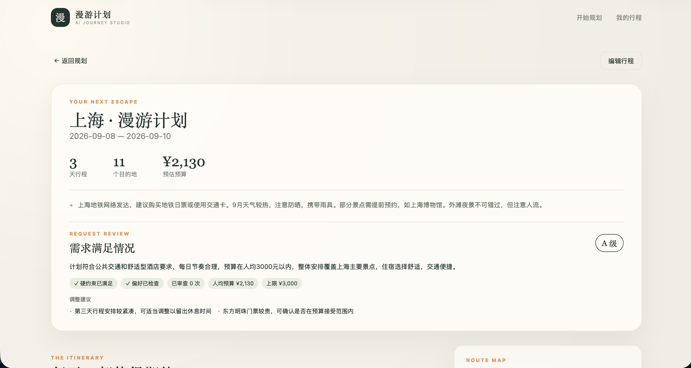
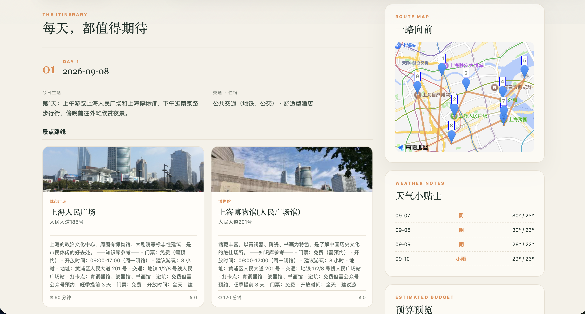
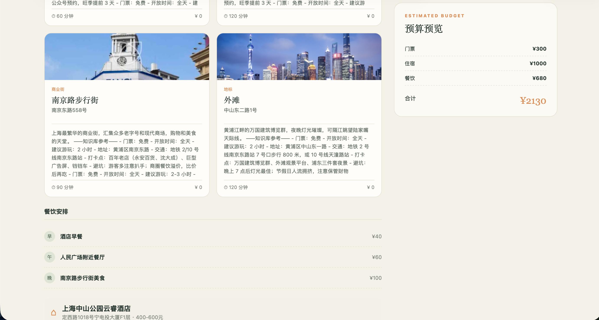
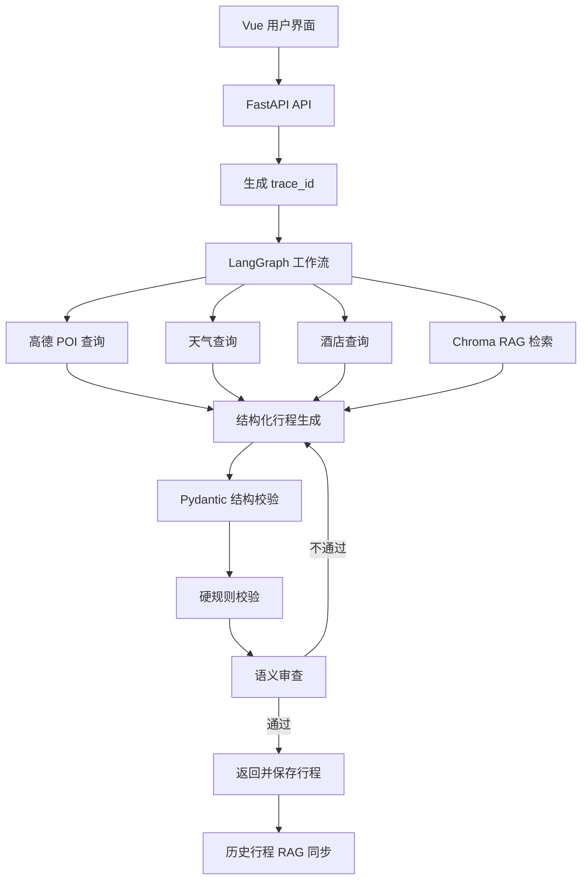

# 漫游计划 · AI 旅行规划 Agent

一个基于 LangGraph 的 AI 旅行规划应用。用户输入目的地、日期、交通、住宿、预算和旅行偏好后，系统会检索城市信息，生成结构化旅行计划，并进行规则校验与语义审查。

> 这是一个面向 AI 应用后端学习与实践的项目，重点关注 Agent 工作流编排、RAG、结构化输出、可靠性和离线评测。

## 项目展示

### 规划首页



### 历史行程



### 行程结果概览



### 每日行程与路线地图



### 餐饮、酒店与预算详情



## 核心功能

- 根据城市、日期、人数、交通、住宿、预算和偏好生成旅行计划
- 调用高德地图 POI 和天气接口获取外部信息
- 使用本地 Chroma 知识库检索城市知识和历史行程
- 根据景点坐标展示路线地图，并在地图 Key 不可用时降级为路线卡片
- 使用 Pydantic 对 LLM 输出进行结构化校验
- 对日期、天数、景点、住宿、餐饮和预算执行确定性硬规则检查
- 对偏好、节奏和交通住宿匹配度进行语义审查
- 审查不通过时携带反馈重新生成，最多重试 3 次
- 保存历史行程，并支持历史行程检索
- 使用 `trace_id` 串联一次请求中的 API、Agent 节点和外部服务日志
- 数据库保存或 RAG 同步失败时降级，不影响已生成的核心行程返回
- 提供离线 Mock 评测和 Live 评测脚本

## 系统架构



## Agent 工作流说明

当前项目使用的是**程序控制的 LangGraph 工作流**，不是 LLM 原生 Tool Calling。

外部能力由工作流节点直接调用：

1. `search_attractions` 调用高德 POI 服务获取景点
2. `get_weather` 获取天气信息
3. `search_hotels` 获取酒店信息
4. RAG 服务补充城市知识和历史行程上下文
5. `generate_trip_plan` 将检索结果和用户需求交给 LLM
6. `review_trip_plan` 执行硬规则检查和语义审查
7. 审查失败时将反馈写回状态，重新生成计划

这种设计的优点是调用顺序和关键参数由程序控制，流程更容易预测和测试；代价是模型不能自主选择工具。后续可以将部分外部能力改造成原生 Tool Calling，以比较两种架构的差异。

## 关键设计决策

### 1. 确定性约束交给程序

日期连续性、行程天数、每日餐饮、景点坐标和预算等规则由 Python 代码检查，而不是只依赖 Prompt。这些规则具有明确的输入和输出，适合用确定性逻辑保证结果稳定。

### 2. 生成与审查分离

计划生成负责产出结构化结果，审查节点负责判断结果是否满足硬约束和用户偏好。硬规则失败或语义审查失败时，系统将问题写回 Graph State，并携带反馈重新生成，最多重试 3 次。

### 3. 核心链路与附加能力解耦

旅行计划生成是核心能力；历史记录保存和历史行程 RAG 同步是附加能力。附加能力失败时记录日志并降级，避免数据库或向量库异常覆盖已经生成的核心结果。

### 4. 评测与外部依赖解耦

评测模块提供 `MockAmapService`、`MockRagService` 和 `MockLLM`，可以在不调用真实服务的情况下验证 Agent 流程、规则检查和报告聚合逻辑。

## 技术栈

### 后端

- Python
- FastAPI
- LangChain
- LangGraph
- Pydantic
- SQLAlchemy
- SQLite 本地数据库和 SQLAlchemy 数据访问层
- ChromaDB
- RabbitMQ、Redis 相关工程实践

### 前端

- Vue 3
- TypeScript
- Vite
- Ant Design Vue
- Axios

## 项目结构

```text
.
├── backend/
│   ├── app/
│   │   ├── agents/       # LangGraph Agent 工作流
│   │   ├── api/          # FastAPI 应用和路由
│   │   ├── core/         # 日志、链路追踪和统一异常
│   │   ├── db/           # 数据库模型和连接
│   │   ├── models/       # Pydantic 请求/响应模型
│   │   └── services/     # LLM、高德、RAG、历史记录服务
│   ├── evaluation/       # 离线评测和 Mock 外部服务
│   ├── tests/            # 后端测试
│   ├── requirements.txt
│   └── .env.example
├── frontend/
│   ├── src/
│   ├── package.json
│   └── .env.example
├── docs/
│   ├── screenshots/
│   └── ...
└── README.md
```

## 本地运行

### 1. 配置后端环境

```bash
cd backend
cp .env.example .env
```

根据实际使用的服务填写 `LLM_API_KEY`、`LLM_BASE_URL` 和 `AMAP_API_KEY`。如果不配置 Embedding，RAG 功能会自动禁用，不影响基本行程生成流程。

### 2. 安装并启动后端

```bash
cd backend
python3 -m venv .venv
source .venv/bin/activate
pip install -r requirements.txt
uvicorn app.api.main:app --reload --port 8000
```

后端 API 地址：<http://localhost:8000>

接口文档：<http://localhost:8000/docs>

### 3. 安装并启动前端

另开一个终端：

```bash
cd frontend
cp .env.example .env
npm install
npm run dev
```

前端地址：<http://localhost:5173>

开发环境下，Vite 会将 `/api` 请求代理到后端的 8000 端口。

## 主要 API

启动后端后，可以访问 <http://localhost:8000/docs> 查看完整的 OpenAPI 文档。主要接口包括：

| 方法 | 路径 | 说明 |
|---|---|---|
| `POST` | `/api/trip/plan` | 生成旅行计划 |
| `GET` | `/api/history` | 查询历史行程 |
| `GET` | `/api/history/{record_id}` | 查看历史行程详情 |
| `PUT` | `/api/history/{record_id}` | 更新历史行程 |
| `DELETE` | `/api/history/{record_id}` | 删除历史行程 |
| `GET` | `/api/poi/photo` | 获取景点图片 |

所有请求会生成 `trace_id`，并通过响应头 `X-Trace-Id` 返回。错误响应包含 `message`、`error_code` 和 `trace_id`，便于定位问题。

## 评测

评测案例位于 `backend/evaluation/cases.jsonl`，每条案例检查结构合法性、日期、天数、餐饮、住宿、预算和审查结果。

### Mock 评测

Mock 评测不依赖真实 LLM 和高德服务，适合验证评测流程：

```bash
cd backend
python -m evaluation.run_evaluation
```

### Live 评测

Live 评测会调用实际配置的外部服务：

```bash
cd backend
python -m evaluation.run_evaluation --live --case-delay 1
```

### 当前评测结果

当前仓库中的 30 条 Live 评测报告显示：

| 指标 | 结果 |
|---|---:|
| 总案例数 | 30 |
| 整体通过 | 28 |
| 合法计划率 | 100% |
| 硬约束通过率 | 100% |
| 平均语义评分 | 85.57 |
| 平均耗时 | 19.24 秒 |
| P95 耗时 | 29.35 秒 |
| 平均业务重试次数 | 0.23 |
| 最终生成失败率 | 0% |

评测报告位于 `backend/evaluation/evaluation_report_live_all.json`。语义评分来自审查流程，仍需要结合人工复核；边界预算案例与正常预算案例应分开解读。

天气数据说明：高德天气接口只返回从当天开始的未来 4 天数据，因此页面展示的是接口实际返回的天气范围，不强行补齐超出接口范围的日期。

## 可靠性设计

- 使用确定性代码校验日期、天数、预算、餐饮和景点信息
- LLM 输出非法 JSON 或不符合结构时重新生成
- 计划审查失败时最多重试 3 次，避免无限循环
- 每个请求生成唯一 `trace_id`
- 记录 Agent 节点开始、完成、失败和耗时
- 数据库历史保存失败时只记录日志，仍返回行程
- RAG 检索或同步失败时降级，不覆盖核心结果
- API 参数错误、业务错误和未捕获异常使用统一错误结构

## 测试

后端测试：

```bash
cd backend
pytest -q
```

前端测试和构建：

```bash
cd frontend
npm run test
npm run build
```

## 面向开发者的排错入口

1. 先从 API 响应头获取 `X-Trace-Id`
2. 在 `backend/logs/app.log` 中搜索对应的 `trace_id`
3. 按 `node_started`、`node_finished`、`node_failed` 查看 Agent 节点耗时和异常
4. 如果请求成功但历史记录缺失，重点检查 `history_persist_failed` 或 `rag_history_sync_failed`

日志文件仅用于本地运行，不应提交到 GitHub。

## 当前边界

当前项目已经完成一个 AI 应用后端的基本业务闭环，但还不是完整的生产级 Agent 平台。暂未覆盖：

- 用户鉴权和权限控制
- API 限流和更完整的熔断策略
- 多用户并发任务和异步任务队列
- LLM 成本统计与更细粒度调用监控
- 原生 Tool Calling
- 大规模线上评测和自动化部署

## 学习与实践重点

本项目主要用于实践以下问题：

- 如何将 LLM 接入真实业务流程
- 如何让 LLM 输出满足稳定的数据结构
- 哪些约束应该交给程序，而不是交给模型判断
- 如何处理 Agent 生成失败、审查失败和外部服务失败
- 如何使用评测数据验证 Agent 的稳定性
- 如何通过日志和 `trace_id` 定位长链路请求问题

## License

本项目仅用于学习和技术实践。
